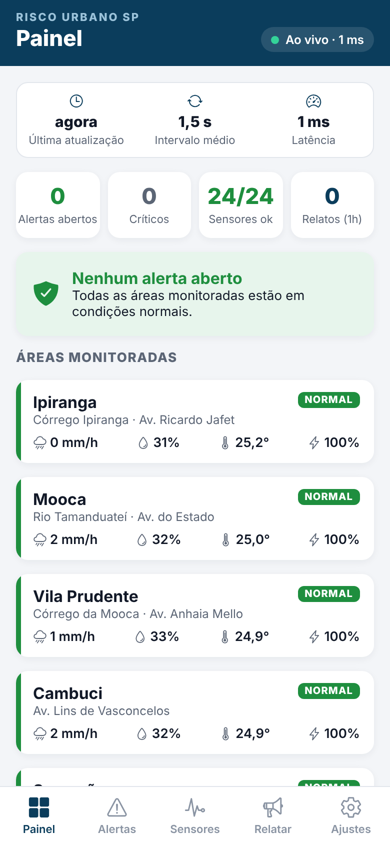
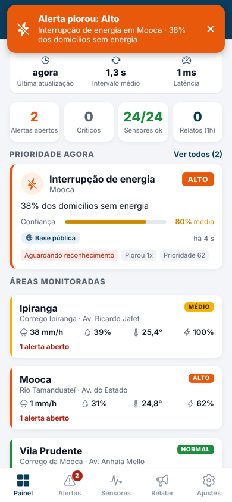
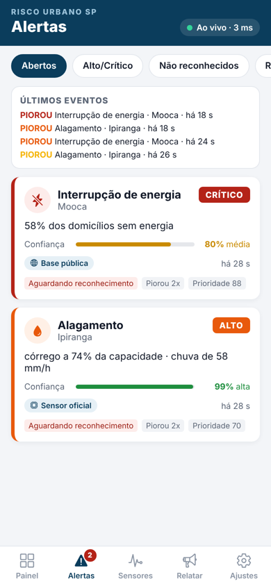
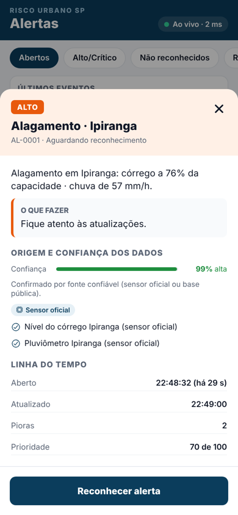
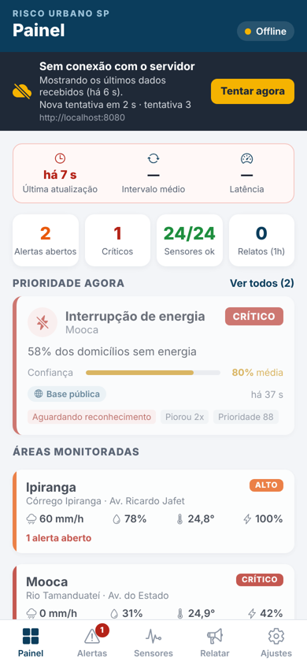
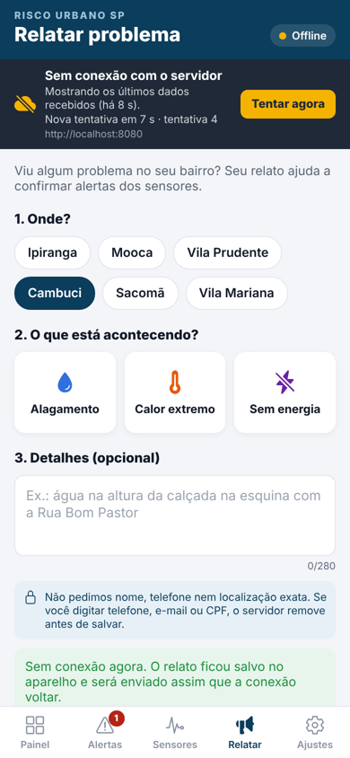
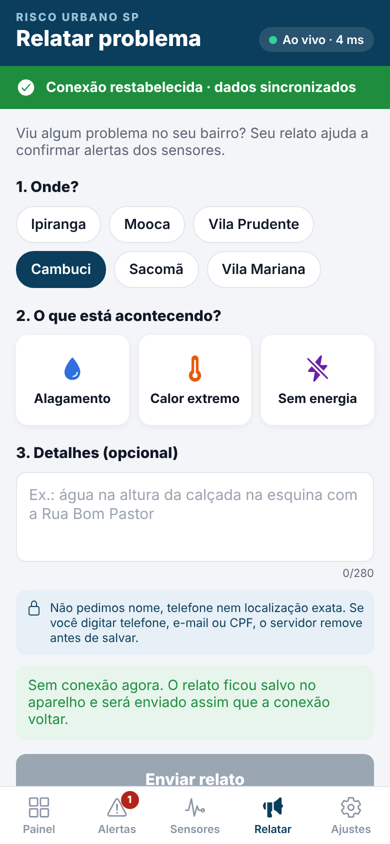
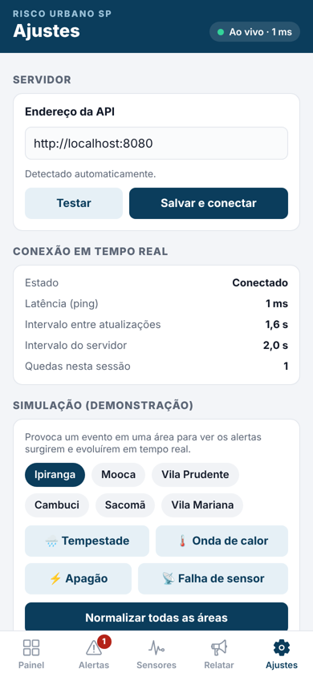

# Risco Urbano SP · Urban Risk Intelligence Platform

Global Solution · **Advanced Programming and Mobile Dev** · Engenharia da Computação · FIAP (3º ano)

Plataforma de monitoramento de riscos urbanos do dia a dia (**alagamentos, ilhas de calor e interrupção de energia**) em bairros da zona sudeste de São Paulo. Uma API **Spring Boot** recebe leituras de sensores, dados de bases públicas e relatos de moradores, avalia o risco de cada área e envia **alertas priorizados em tempo real** para um aplicativo **React Native (Expo)**. Cada alerta mostra **de onde vieram os dados e qual o nível de confiança**.

O app foi pensado para não travar quando o servidor cai: ele avisa que está desconectado, continua mostrando os últimos dados (marcados como desatualizados), guarda os relatos para enviar depois e se reconecta sozinho quando o backend volta.

## Vídeo da demonstração

▶️ **https://youtu.be/A75axkqiraU** (cerca de 2 min): API Spring Boot rodando, app recebendo dados em tempo real, alerta de tempestade escalando até Crítico, backend parado com o app avisando que está desconectado sem travar, e reconexão automática com envio do relato que estava na fila.

## Integrantes

| Nome completo | RM |
|---|---|
| Henrique Monteiro Khouri | 555572 |
| Rodrigo Arantes da Silva Philippi | 557594 |

Turma: 3ECR

## Telas

| Painel | Alerta chegando | Alertas | Detalhe (origem e confiança) |
|---|---|---|---|
|  |  |  |  |

| Backend parado | Relato salvo offline | Reconectado | Ajustes e simulação |
|---|---|---|---|
|  |  |  |  |

## Arquitetura

```
┌──────────────────────── Backend (Spring Boot 3.5 · Java 17) ────────────────────────┐
│                                                                                      │
│  SimuladorSensores ──► MonitoramentoService ──► MotorDeRegras                        │
│  (a cada 2 s: chuva,     (ciclo agendado,         (nível + confiança                 │
│   nível do córrego,       abre/escalona/           por tipo de risco)                │
│   temperatura, energia)   resolve alertas)                                           │
│                                │                                                     │
│          relatos (POST) ───────┤ publica eventos                                     │
│                                ▼                                                     │
│   REST /api/**  ◄──────  TempoRealHandler (WebSocket /ws)                            │
└───────────▲──────────────────────┬───────────────────────────────────────────────────┘
            │ HTTP (ações)         │ snapshot · tick · alerta · heartbeat · pong
┌───────────┴──────────────────────▼──── App (React Native · Expo · TypeScript) ───────┐
│  ConexaoTempoReal (detecção de queda, reconexão, ping)                               │
│  MonitoramentoContext (estado, cache offline, fila de relatos)                       │
│  Telas: Painel · Alertas · Sensores · Relatar · Ajustes                              │
└──────────────────────────────────────────────────────────────────────────────────────┘
```

| Camada | Tecnologias |
|---|---|
| Backend | Java 17, Spring Boot 3.5 (Web, WebSocket, Validation, Actuator), JUnit 5, MockMvc |
| App | React Native 0.88, Expo SDK 58, TypeScript, AsyncStorage |
| Execução | Maven Wrapper (incluso), Docker (opcional), Expo Go |

## Como executar

### Pré-requisitos

- **JDK 17 ou superior** (para o backend). Não precisa instalar o Maven: o projeto traz o `mvnw`.
- **Node.js 20 ou superior** (para o app).
- Para testar no celular: app **Expo Go** (Android ou iOS) atualizado, com o celular **na mesma rede Wi-Fi** do computador.

### 1. Backend (Spring Boot)

```bash
cd backend

# Windows (PowerShell ou CMD)
.\mvnw spring-boot:run

# Linux / macOS
./mvnw spring-boot:run
```

A API sobe em `http://localhost:8080` (na primeira execução o wrapper baixa o Maven e as dependências; demora um pouco). Para conferir:

```bash
curl http://localhost:8080/api/status
curl http://localhost:8080/api/painel
```

Outras formas de rodar:

- **Maven instalado:** `mvn spring-boot:run` dentro de `backend/`.
- **IDE (IntelliJ / VS Code / Eclipse):** abrir a pasta `backend` como projeto Maven e executar `UrbanRiskApplication`.
- **Docker (sem Java):** na raiz do repositório, `docker compose up --build`.

Testes automatizados: `./mvnw test` (ou `.\mvnw test` no Windows).

> Se o Windows Firewall perguntar, permita o acesso do Java à **rede privada**, senão o celular não alcança a API.

### 2. App (React Native / Expo)

Em outro terminal:

```bash
cd mobile
npm install
npx expo start
```

- **Celular:** escaneie o QR code com o Expo Go (Android) ou com a câmera (iOS). O app descobre sozinho o IP do computador e conecta em `http://<ip-do-computador>:8080`.
- **Navegador:** tecle `w` no terminal do Expo (abre em `http://localhost:8081`).
- **Emulador Android:** tecle `a`. O app usa `10.0.2.2:8080` automaticamente.

Se a conexão não acontecer (rede da faculdade, VPN, modo túnel do Expo), abra a aba **Ajustes**, digite o endereço da API (ex.: `192.168.0.15:8080`), toque em **Testar** e depois em **Salvar e conectar**. Para descobrir o IP do computador: `ipconfig` (Windows) ou `ifconfig`/`ip a` (Linux/macOS).

## Roteiro da apresentação

1. **API rodando:** mostrar o terminal do backend e abrir `http://localhost:8080/api/status` no navegador.
2. **App recebendo dados em tempo real:** no Painel, o indicador **"Última atualização"** fica entre "agora" e "há 2 s" e as leituras mudam sozinhas. No topo aparece **"Ao vivo · X ms"** (latência medida com ping/pong).
3. **Gerar um evento:** em **Ajustes → Simulação**, escolher *Ipiranga* e tocar em **Tempestade**. Em poucos segundos chega o alerta de alagamento, que piora de nível conforme o córrego enche (Médio → Alto → Crítico), com notificação na tela e vibração no celular. Abrir o alerta e mostrar **origem, confiança, fontes e recomendação**; tocar em **Reconhecer**.
4. **Parar o backend:** `Ctrl + C` no terminal da API (ou `docker compose stop api`). Em até 1 s o app mostra **"Sem conexão com o servidor"**, há quanto tempo os dados estão parados e a contagem para a próxima tentativa. Navegar entre as abas para mostrar que **nada trava**: os dados continuam na tela, esmaecidos. Na aba **Relatar**, enviar um relato: ele fica **na fila do aparelho**.
5. **Religar o backend:** `.\mvnw spring-boot:run` de novo (ou `docker compose start api`). O app **reconecta sozinho**, mostra **"Conexão restabelecida · dados sincronizados"**, recebe o estado completo e **envia o relato que estava na fila**.

> Observação: os alertas e cenários ficam em memória, então ao reiniciar o backend eles começam do zero. Isso é esperado: a demonstração é sobre o app se recuperar sem ser reaberto.

## Como o app lida com a queda do servidor

| Situação | O que o app faz |
|---|---|
| Servidor encerrado (processo parado) | O WebSocket fecha e o aviso aparece na hora. |
| Servidor mudo (rede caiu sem avisar) | O servidor envia algo a cada 2 s (tick ou heartbeat). Sem nada por **6 s**, o app considera a conexão perdida. |
| Handshake travado | Desiste após **5 s** e tenta de novo. |
| Tentativas de reconexão | Espera crescente de 1, 2, 4, 8 e 10 s (com pequena variação aleatória), com botão **Tentar agora**. Ao voltar para o app (segundo plano → primeiro plano) tenta na hora. |
| Ao reconectar | O servidor manda um **snapshot** completo e o app substitui tudo, sem precisar recarregar. Se faltar alguma mensagem na sequência (`seq`), o app pede `sync`. |
| Requisições HTTP | Todas têm tempo limite (3 a 5 s) e mostram erro amigável, nunca uma tela presa. |
| Abrir o app sem servidor | Mostra o último painel salvo no aparelho (AsyncStorage), avisando que é um dado antigo. |
| Relato sem conexão | Fica numa fila salva no aparelho e é enviado automaticamente quando a conexão volta. |

O código está em [`mobile/src/realtime/ConexaoTempoReal.ts`](mobile/src/realtime/ConexaoTempoReal.ts) e [`mobile/src/state/MonitoramentoContext.tsx`](mobile/src/state/MonitoramentoContext.tsx).

## Indicadores do desafio

**Tempo de atualização**
- O backend gera leituras e reavalia os alertas a cada **2 s** (`app.simulacao.intervalo-ms`), e o app recebe por **push** (WebSocket), sem polling.
- Relatos e reconhecimentos são reavaliados e difundidos **na hora**, sem esperar o próximo ciclo.
- O app exibe a última atualização, o intervalo médio entre atualizações e a latência (ping/pong) no Painel e em Ajustes.

**Qualidade dos alertas**
- **Confiança combinada das fontes:** cada origem tem uma confiança base (sensor oficial 95%, base pública 80%, relato da comunidade 45%). Fontes independentes que concordam aumentam a confiança: `1 − Π(1 − cᵢ)`, com limite de 99%. Vários relatos contam como uma fonte que fica mais confiável a cada relato (até 75%).
- **Dado desatualizado vale menos:** um sensor sem leitura há mais de 10 s tem a confiança reduzida pela metade e aparece como "sem atualização".
- **Alertas com confiança abaixo de 60%** aparecem como *Não confirmado*.
- **Sem duplicidade:** um alerta aberto por área e tipo de risco, que é escalonado quando piora (e volta a pedir atenção mesmo se já reconhecido).
- **Sem "pisca-pisca":** só rebaixa ou resolve depois de 3 ciclos seguidos com condição melhor (histerese).
- **Priorização:** a prioridade (0 a 100) combina a gravidade com a confiança, e a lista vem ordenada por ela.
- Cada alerta traz mensagem, recomendação prática, valores de referência e a lista de fontes.

**Facilidade de uso**
- Cores e rótulos de nível sempre juntos (não depende só da cor), com textos curtos.
- Notificação na tela (com vibração no celular) só para alertas **Alto** e **Crítico**, para não cansar o usuário.
- Relato em 3 toques (área, tipo e enviar), com descrição opcional.
- Endereço do servidor detectado automaticamente, com tela para testar e trocar.
- Rótulos de acessibilidade (`accessibilityLabel`/`accessibilityRole`) nos elementos interativos.

## Regras de alerta

| Risco | Fonte | Baixo | Médio | Alto | Crítico |
|---|---|---|---|---|---|
| Alagamento | Nível do córrego (% da capacidade) | — | ≥ 65 | ≥ 80 | ≥ 95 |
| | Chuva (mm/h) | ≥ 10 | ≥ 25 | ≥ 50 | — |
| | Córrego ≥ Alto **e** chuva ≥ Médio | | | | sobe um nível |
| | Relatos (15 min) | 1 | 2 | ≥ 3 | — |
| Ilha de calor | Temperatura (°C) | ≥ 32 | ≥ 34 | ≥ 37 | ≥ 39 |
| | Relatos (15 min) | 1–2 | ≥ 3 | — | — |
| Falta de energia | Domicílios com energia (%) | ≤ 95 | ≤ 85 | ≤ 70 | ≤ 50 |
| | Relatos (15 min) | 1 | 2 | ≥ 3 | — |

Implementação: [`backend/src/main/java/br/com/fiap/urbanrisk/alerta/MotorDeRegras.java`](backend/src/main/java/br/com/fiap/urbanrisk/alerta/MotorDeRegras.java).

## API

| Método | Rota | Descrição |
|---|---|---|
| GET | `/api/status` | Saúde da API e número de apps conectados |
| GET | `/api/painel` | Estado completo: resumo, áreas, alertas, sensores (com histórico), relatos e cenários |
| GET | `/api/areas` | Áreas monitoradas com o risco atual |
| GET | `/api/sensores` · `/api/sensores/{id}` | Sensores (o detalhe inclui histórico) |
| GET | `/api/alertas` · `?status=resolvidos` | Alertas abertos por prioridade, ou os resolvidos |
| GET | `/api/alertas/{id}` | Detalhe do alerta |
| POST | `/api/alertas/{id}/reconhecer` | Marca o alerta como visto por um agente |
| GET / POST | `/api/relatos` | Lista ou cria um relato `{ "areaId", "tipo": "ALAGAMENTO \| CALOR_EXTREMO \| SEM_ENERGIA", "descricao" }` |
| GET / POST / DELETE | `/api/simulador/cenarios` | Lista, ativa `{ "areaId", "cenario": "TEMPESTADE \| ONDA_DE_CALOR \| APAGAO \| FALHA_SENSOR", "duracaoSegundos" }` ou normaliza tudo |

Erros voltam padronizados: `{ status, erro, mensagem, campos, ts }` (400 validação, 404 não encontrado, 409 conflito).

### Tempo real: `ws://<host>:8080/ws`

| Direção | `tipo` | Conteúdo |
|---|---|---|
| servidor → app | `snapshot` | Estado completo, enviado ao conectar ou após `sync` |
| servidor → app | `tick` | Estado atualizado a cada ciclo (2 s) |
| servidor → app | `alerta` | `evento`: `NOVO`, `ESCALONADO`, `ATUALIZADO`, `RECONHECIDO` ou `RESOLVIDO` |
| servidor → app | `relato` | Novo relato da comunidade |
| servidor → app | `heartbeat` | Sinal de vida quando não houve outra mensagem |
| app → servidor | `ping` / `sync` | Mede latência (o servidor responde `pong`) / pede o snapshot de novo |

Toda mensagem difundida tem `seq` (número crescente) e `ts`.

## Privacidade (LGPD)

- O relato **não tem** campos de nome, telefone ou localização exata, só a área e o tipo.
- O backend **remove** e-mail, telefone e CPF digitados na descrição antes de salvar ([`Anonimizador`](backend/src/main/java/br/com/fiap/urbanrisk/privacidade/Anonimizador.java)).
- Nada do usuário é guardado no servidor além do relato anonimizado.

## Testes

```bash
cd backend && ./mvnw test        # Windows: .\mvnw test
cd mobile && npx tsc --noEmit    # checagem de tipos do app
```

- `MotorDeRegrasTest`: níveis, combinação de confiança, relato isolado, dado desatualizado.
- `MonitoramentoServiceTest`: tempestade abre → escalona → resolve; reconhecer e voltar a ativo quando piora; relato anonimizado; falha de sensor.
- `ApiIntegrationTest`: endpoints REST (200/201/400/404) e WebSocket (snapshot, tick e ping/pong).

O workflow em `.github/workflows/ci.yml` roda os testes do backend e a checagem do app a cada push.

## Estrutura

```
backend/                      API Spring Boot
  src/main/java/br/com/fiap/urbanrisk/
    domain/                   Área, Sensor, Alerta, Relato e enums
    simulacao/                simulador de sensores e cenários
    alerta/                   motor de regras (nível + confiança)
    service/                  ciclo de monitoramento e ciclo de vida dos alertas
    realtime/                 WebSocket (TempoRealHandler)
    api/                      controllers REST, DTOs e tratamento de erros
    privacidade/              anonimização dos relatos
    store/                    armazenamento em memória
  src/test/java/...           testes unitários e de integração
mobile/                       App React Native (Expo)
  src/realtime/               conexão WebSocket com reconexão
  src/state/                  estado global, cache e fila offline
  src/screens/                Painel, Alertas, Sensores, Relatar, Ajustes
  src/components/             componentes visuais
docs/img/                     capturas de tela
docker-compose.yml            sobe a API com Docker
```

## Limitações

- Sensores, bases públicas e cenários são **simulados**. Em produção, o `SimuladorSensores` seria trocado por integrações reais (ex.: CGE, INMET, dados abertos da concessionária) mantendo o mesmo motor de regras.
- O armazenamento é em memória (reiniciar a API zera alertas e relatos). Um banco (PostgreSQL) entraria na camada `store` sem mudar as regras.
- Não há autenticação: o reconhecimento de alertas seria restrito a agentes locais numa versão real.
